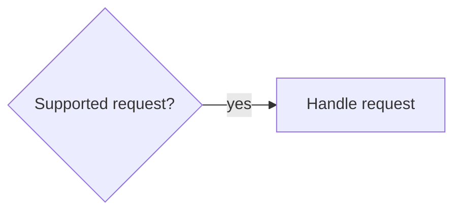
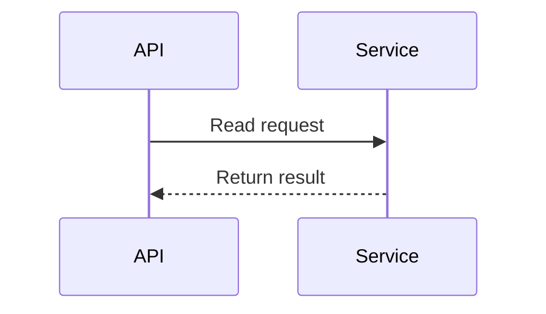

# Optional change diagrams

A review can include one model-proposed summary of the changed behavior. The
model chooses a flowchart for conditions and branches, or a sequence diagram for
ordered interactions between components. Findings remain the primary review
signal. A diagram may omit routes and error handling; valid source locations do
not prove that the proposed behavior is correct.

Set `OCR_REVIEW_DIAGRAM_MODE` for both review and posting:

| Value | GitLab review | Standalone `--local` review |
| --- | --- | --- |
| `on` (unset default) | Request and show expanded | Do not request |
| `off` | Do not request or publish | Do not request |
| `spoiler` | Request and show collapsed | Do not request |
| `local` | Configuration error before acquisition | Request for private Markdown |

Blank, differently cased and unknown values are configuration errors. Private
artifacts from a GitLab run retain that run's GitLab mode. Posting may suppress
an admitted diagram with `off`, or collapse an admitted `on` diagram with
`spoiler`; it cannot enable a diagram that review did not request.

For example, add `OCR_REVIEW_DIAGRAM_MODE=local` to the environment of the
[local review command](local.md). Its private Markdown contains both a Mermaid
fence and a complete text equivalent. GitLab uses the same admitted model with
expanded or collapsed presentation. No external rendering service is required.

The two summary forms look like these simplified examples:

Production output also supplies mechanically checked paths and inclusive line
ranges at the effective immutable reviewed head. It never derives a diagram
from finding prose or runs a second review/model pass. The first qualified
native capability is OCR **1.13.3**; an unqualified version reports `unsupported`.

The fixed internal `ocr_toolkit_review_diagram` MCP tool accepts typed data into
one private run collector. The model selects no output path, network destination
or publication action. Existing evidence/context tools keep their read-only
behavior. Raw Mermaid, HTML, directives and styling are not accepted; the
toolkit renders identifiers, arrows, escaping and text deterministically.

Limits apply to the whole candidate:

- Flowchart: fixed `LR`, at most 12 nodes and 16 edges.
- Sequence: at most eight participants, 16 messages across **all** branches,
  four two-way `alt` fragments and nesting depth two.
- Candidate: 16 KiB; each label/condition is one line, at most 80 code points and
  320 UTF-8 bytes; each source-bearing element has one or two references.
- Run collector: at most eight submissions and 128 KiB of original wire input.
  Identical normalized repeats are idempotent. Different candidates, invalid
  submissions or exhausted budgets omit the whole diagram; fragments are never
  merged and arrival order does not select a winner.

The runner snapshots the candidate before cleanup, then checks the final native
range identity, endpoints, IDs, nesting, budgets, source paths/lines and whole
original text through DLP. A sensitive condition is never redacted into a
different route: the entire optional diagram is omitted. Publication rechecks
the immutable source references and DLP; a GitLab note budget also omits the
whole diagram rather than cutting its conditions.

Technical details record `disabled`, `not-applicable`, `unsupported`, `generated`,
`not-generated` or `omitted-invalid`. No candidate, MCP output failure, unsafe
collector, source-read failure, cleanup failure or rendering error changes
findings, native coverage, review outcome or approval eligibility. A bounded
warning may be logged. Mandatory evidence/range failures retain their normal
gates. A malformed persisted result/receipt is still rejected atomically;
optional-channel recovery does not make hostile handoffs valid.
