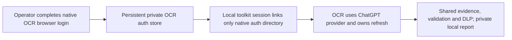

# Standalone local review

Use the local provider to review immutable Git changes and read the admitted
findings in a Markdown artifact and the console, without connecting the repository to a forge.
Install the toolkit and its [qualified OCR binary](../compatibility/ocr-support.json),
then configure the LLM environment described in [configuration.md](configuration.md).

<!-- ew:invariant id="local-review.preparation" -->
## Review preparation

Choose the authentication mode before preflight. API mode requires an exact
`OCR_LLM_MODEL` and its endpoint/token configuration; native ChatGPT mode uses
the [setup below](#native-chatgpt-setup) and `OCR_LLM_AUTH_MODE=chatgpt` without
API-only variables. Check that `ocr` on the review command's `PATH` is the
checksum-verified version in the [compatibility manifest](../compatibility/ocr-support.json).
For native ChatGPT mode, run `ocr llm models` with that same executable before a
long review: toolkit preflight checks local store metadata but does not test
model reachability, account eligibility, or a host firewall rule.

Use only arguments accepted by the standalone local path after `--`. In
particular, `--background` and `--background-file` are unsupported for local
review and are rejected before OCR runs. Check `ocr-ci review --help`, the
[local input contract](#inputs-and-isolation), and the exact invocation before
starting the model.

```console
ocr-ci preflight --local
review_dir=$(mktemp -d)
review_dir=$(cd "$review_dir" && pwd -P)
ocr-ci review --local --result "$review_dir/review.json" --stderr "$review_dir/review.stderr" --report "$review_dir/review.md" -- --commit HEAD
```

Keep all three output paths in that new private directory. Resolve its physical
path before launch. `/tmp` can be a symlink on macOS or Linux, while a mounted
directory can have no symlink at all. The runner checks the actual path
components and rejects symlinks and parent-opening errors before OCR starts.
It reopens the destination directory when publishing the report. Check the
report path is fresh and wait for the `ocr-ci` exit status;
an OCR JSON file alone does not establish successful local delivery. After a
zero exit, read the complete private Markdown and JSON: require `status=complete`,
compare selected/completed/reused/failed/waived coverage, inspect DLP admission and
every admitted finding, and inspect stderr for failed auxiliary tool reads that
could limit the conclusion. For each failed `file_read`, compare its path and
range with the reviewed tree and decide whether the missed context bears on
the changed code or a finding. A native complete manifest proves selected-file
completion, not that every auxiliary read succeeded; resolve a material gap
before accepting the local review. Preserve these artifacts until findings are
fixed and the corrected head has been reviewed.

For a range, replace `--commit HEAD` with `--from BASE --to HEAD`. Both ends are
resolved to immutable commits before execution. Working-tree snapshots, repository
scans, resumed sessions and competing repository/background inputs are unsupported.
The toolkit owns JSON output and agent audience; contradictory `--format` or
`--audience` options fail before execution.

Only one review may use a checkout's private `.review-context/` artifacts at a
time. The toolkit holds a private nonblocking lock for the entire review; a
second run in that checkout fails without clearing the first run's artifacts.
Use separate worktrees when concurrent local reviews are needed.
The second run exits with code `75` and does not claim the first run's report path.

## Inputs and isolation

Local mode is explicit. It may run in a CI test job, but inherited CI identity does
not select a forge provider, acquire change-request data or authorize publication.
`preflight --local` checks the OCR binary and configured LLM, not forge access.
Set `OCR_REVIEW_CONTEXT_MODE` to `off` or leave it unset; other context modes and
legacy adapter configuration are rejected before input acquisition.
Local mode has no discussion, command, suppression or approval channel.

## LLM authentication

Local review uses the configured API provider by default, including custom
OpenAI-compatible or Anthropic endpoints. `OCR_LLM_AUTH_MODE=api-key` is the
default for both local and GitLab execution; the existing endpoint, token,
protocol and model configuration continues to apply.

### Native ChatGPT setup

With the native-auth version listed in the [compatibility policy](compatibility.md),
local review can instead use OCR's optional native ChatGPT-plan authentication.
This option requires POSIX ownership and permission checks (Linux or macOS).
Use it on a trusted personal host; do not mount personal ChatGPT credentials in
shared CI. GitLab and shared automation should use API authentication.
Install the toolkit and checksum-verified OCR as described in the
[installation guide](../README.md#install). OCR remains a separate executable.
Authorize OCR from your normal user session:

```console
ocr auth login --provider chatgpt
ocr llm models
```

Complete OCR's browser authorization, including any requested plan consent.
Available models and account eligibility are determined by OCR and OpenAI.
If OCR retains the account but reports that plan usage is disabled, request
consent for that same registration with
`ocr auth login --provider chatgpt --enable-plan`; this does not require a new
account or host registration.
Then select the mode in an environment without API-only configuration:

```console
unset OCR_LLM_URL OCR_LLM_TOKEN OCR_LLM_PROTOCOL OCR_LLM_AUTH_HEADER \
  OCR_LLM_EXTRA_HEADERS OCR_LLM_EXTRA_BODY OCR_LLM_MODELS_URL \
  OCR_LLM_ALLOWED_MODELS OCR_LLM_VALIDATE_MODEL OCR_LLM_MAX_COMPLETION_TOKENS \
  OCR_ANTHROPIC_DISABLE_THINKING OCR_USE_ANTHROPIC OCR_LLM_MODEL OCR_LLM_REASONING_EFFORT
export OCR_LLM_AUTH_MODE=chatgpt
# Optional: set OCR_LLM_MODEL to an exact model available to this account.
review_dir=$(mktemp -d)
review_dir=$(cd "$review_dir" && pwd -P)
ocr-ci preflight --local
ocr-ci review --local --result "$review_dir/review.json" --stderr "$review_dir/review.stderr" --report "$review_dir/review.md" -- --commit HEAD
```

The existing local preflight checks the qualified binary and the native store's
filesystem safety. It does not make a model request or prove consent, token
freshness, account eligibility or quota; OCR checks these on actual use. API URL,
token, protocol, header, model-validation and completion-cap settings cannot be
combined with ChatGPT mode. Optional reasoning configuration uses the native
Responses shape; only `reasoning`, `text` and `prompt_cache_key` body overlays
are accepted. Provider selection cannot be overridden through review arguments.

`OCR_LLM_MODEL` is optional in this mode: unset uses OCR's native default.
Use `ocr llm models` to discover account-specific choices before selecting a
model. `OCR_LLM_REASONING_EFFORT` is also optional and uses the same explicit
values described in [configuration](configuration.md#provider-endpoint-and-completion-cap-contract);
the selected model must support the requested effort. The toolkit does not
silently substitute another model or effort after a provider rejection.

### What connects and what persists

Ordinary preflight and review never start login. OCR reuses its persistent
`~/.opencodereview/auth/chatgpt` account/host store and owns refresh and locking.
The active native OCR registration selects the account; manage account switching
and sign-out through OCR, rather than editing or copying its authentication files.
The toolkit links only that validated private directory into its temporary
runtime HOME; it does not copy credentials or inherit the operator's OCR config.
Session cleanup removes the private link and runtime config, preserving native
registration and refresh state for the next run. Do not use OCR's
`--new-account` option for routine repeated reviews.

ChatGPT mode requires explicit `--local`. GitLab execution rejects it before
opening the auth store and continues to use API providers. Failed ChatGPT auth
does not switch providers or fall back to API billing. To return to an API
provider locally, unset `OCR_LLM_AUTH_MODE` or set it to `api-key`, then supply
the usual API configuration.

OCR sends the admitted review inputs to OpenAI through its native ChatGPT
provider and the public Responses API, using the operator-authorized account.
Local execution describes Git input and report delivery; it does not mean
offline inference. OpenAI determines subscription eligibility, available models
and usage limits. The toolkit does not import ChatGPT conversations or use a
Codex credential cache. It keeps the same mandatory evidence, validation and
DLP pipeline; a subscription does not bypass repository/service egress rules.
See the [OCR native-provider guide](https://github.com/alibaba/open-code-review/blob/v1.13.3/pages/src/content/docs/en/chatgpt-preview.md)
and [OpenAI's token-sharing overview](https://developers.openai.com/siwc/token-sharing-open-source).



### Authentication troubleshooting

| Observation | Operator action |
| --- | --- |
| Explicit local mode required | Use `preflight --local` and `review --local`, or configure an API provider for GitLab. |
| API settings conflict | Clear the API-only settings shown above; do not combine a custom endpoint or token with ChatGPT mode. |
| Native registration missing or unsafe | Run native login in the normal user session and keep its store operator-owned and private. Do not copy token files into the repository or weaken checks. |
| Account retained but plan usage disabled | Run `ocr auth login --provider chatgpt --enable-plan` for the retained registration and complete consent. |
| Model, grant, expiry or quota rejected | Follow OCR's native diagnostic; use the account's model catalog or restore account access/limits. There is no automatic API fallback. |
| A newly installed OCR binary times out at `/v1/models` | Check the local firewall rule for that exact executable and run `ocr llm models` before a long review. A successful toolkit preflight checks store metadata but does not test network access. |
| Preflight passes but review fails | Preflight proves structural readiness only. Inspect the normal private stderr or an authorized debug bundle; a failed or rejected review is not a successful report. |

### Evidence and external tools

Set `OCR_REVIEW_DIAGRAM_MODE=local` to request one optional flowchart or sequence
summary in the private report. Unset/`on`, `spoiler` and `off` do not request a
standalone diagram. [Diagram modes, bounds and failure behavior](diagrams.md)
also describe the Mermaid and complete text output. Diagram errors leave the
review and findings usable.

The mandatory repository-evidence MCP remains enabled. Registry validation and
the toolkit's self-query do not substitute for the review's completed evidence
summary call: the result's claimed usage must reconcile with the real action
record. Operator-configured registry-v2 upstreams remain optional and cannot
replace mandatory evidence. Local permits reviewed HTTPS and explicit stdio
transports; their trust boundaries are described in
[governed MCP federation](configuration.md#governed-mcp-federation-and-trust-boundary).

## Output and failures

Standard output contains shared review health, coverage, warnings, tool/token and
verified MCP facts, DLP admission status, and every admitted finding. It has no
posting caps, remote badges, HTML disclosures or platform publication claims.
Finding text and code are rendered as literal fenced content. Diagnostics use
standard error; JSON stays in the private `--result` artifact.

The same complete Markdown is published to `--report PATH`, defaulting to the
`--result` path plus `.md`. The report target must be fresh and distinct from
JSON/stderr; existing files and symlinks are never overwritten. Publication is
atomic with owner-only (`0600`) permissions. This is the same OCR/LLM/tool-use,
validation and DLP pipeline as CI, with local filesystem delivery instead of
forge API publication. It does not replace OCR with another local review engine.
The private report parent is opened descriptor-relative without following any
pathname symlink, then the temporary and final entries are created through that
pinned directory. A same-user replacement of a parent path cannot redirect
report delivery.

Successful execution still requires result validation and cleanup. DLP is enabled
by default. The
admitted JSON has no fabricated forge receipt. Filtered findings stay absent from
the console and safe JSON; omissions and original coverage remain explicit.
Legacy results without coverage counts remain unknown, not a fabricated complete
coverage manifest. A blocked run returns nonzero and prints a closed failure
summary naming its stage without presenting untrusted findings. An unavailable
output stream cannot guarantee delivery of that summary. Failures after the
report destination has been accepted also publish the closed failure report;
configuration or unsafe-destination failures print only to the console. A failed
artifact or console delivery returns nonzero; a completed artifact remains
available if the console fails afterward.

With qualified OCR 1.13.3, a changed Git submodule pointer can be excluded
automatically while selected ordinary files are reviewed. Local Markdown
states the effective repository coverage separately from the native OCR
manifest; the changed pointer and submodule contents remain unreviewed. A
gitlink-only or fully excluded ordinary diff stops before the model with exit
2 and a closed no-model coverage statement. An unsafe or unqualified pointer
shape stops without a coverage claim. The toolkit never initializes or fetches
submodules, and MCP context cannot turn a skipped pointer into a reviewed file.

Before disabling DLP to diagnose a suspected false positive, run
`ocr-ci review --local --preserve-private-artifacts` with the normal private
result, stderr, and report paths. After valid bounded output, it retains
owner-only private inputs, the raw marked diagnostic JSON, and DLP decisions
without creating a posting-eligible receipt. The local Markdown and console
report still contain only admitted findings. Inspect the retained material only
on the trusted host, keep it out of commits and shared artifacts, and remove it
after diagnosis. This option cannot be combined with `--debug-dir`.

`OCR_DLP_ENABLED=false` is a strict per-run escape hatch. It disables
context/federation and publication DLP, emits a prominent Markdown and console
warning, and makes the result approval-ineligible. Local Markdown may then
contain sensitive repository, service, model, or credential-adjacent data. The
same setting in GitLab can publish such data, and re-enabling DLP cannot retract
anything already sent or written. Invalid non-boolean values fail before OCR;
non-DLP schema, size, origin, evidence, cleanup and output-safety gates remain.

## Private debug bundle

Add `--debug-dir PATH` to retain diagnostics from the same review execution.
The directory must be fresh, must not traverse symlinks, and must not contain
the normal result, stderr or report destinations. It is created with mode `0700`;
its files use `0600`. This option requires `--local` and is separate from private
artifact retention. It does not bypass validation, DLP or ordinary session cleanup.
Its parent directory is pinned before the bundle is created, and every later
write is descriptor-relative; replacing a visible ancestor path cannot redirect
diagnostics to a different directory.

| Artifact | Contents | Maximum retained bytes |
| --- | --- | --- |
| `raw-result.json` | Original OCR output before finalization, when execution reached OCR | 20,000,000 |
| `raw-stderr.log` | Original OCR diagnostic stream | 2,000,000 |
| `safe-result.json` | Successfully finalized JSON, if available | 20,000,000 |
| `summary.md` | Admitted report or closed failure summary | 20,000,000 |
| `journal.json` | Actual phase observations and value-free DLP decisions | 1,000,000 |

Raw files can contain rejected confidential content. Do not upload the bundle
as a public CI artifact. No environment dump, authentication token, full runtime
configuration or OCR session is copied into it. Configuration observations name
the selected protocol, language, review effort and logging flags; the model
selection is represented by a SHA-256 fingerprint, not provider acceptance.

The journal records passed, failed, degraded and not-run checks at their execution
owners. Passing a collection phase does not imply complete repository coverage;
coverage remains a separate review fact. DLP entries describe real detection,
omission or redaction branches, with bounded locations, sizes and value digests.
They are not the results of a second DLP scan and do not authorize publication.
At most 1,000 DLP decisions and 128 phase transitions are retained; omitted counts
remain explicit. Unknown field names are fingerprinted rather than copied.

Capture metadata distinguishes missing, unavailable and not-run artifacts.
Truncation and source changes are explicit. `sha256_captured` covers only the
retained bytes, never an implied complete source. A truncated Markdown/JSON copy
may end inside a UTF-8 character or JSON value; use the normal artifact for the
complete admitted output.

`complete: true` means the journal's observation lifecycle finished, not that the
review succeeded. Initial snapshots have `complete: false`. An unsafe initial
directory fails before review. Later diagnostic write failures do not replace the
review outcome or suppress cleanup: unavailable captures are marked in the journal,
and a journal write failure emits a bounded stderr warning. An earlier incomplete
snapshot can remain when the final journal cannot be written.

## Configured external qualification

Deterministic installed tests and real-OCR no-LLM probes do not establish model
quality, live GitLab behavior or provider reasoning support. Before promoting a
Draft, the external owner should record the exact Draft head, installed artifact
digest, OCR asset identity and provider/model/protocol for these checks. Do not
install the older stable toolkit pin from the GitLab example for this exercise;
use the wheel built by the exact Draft's Build artifacts workflow in an isolated
environment. Keep the example's stable toolkit pin unchanged until release.

- GitLab: run the configured review and inspect admitted findings, mandatory
  evidence use, receipt identity and the intended discussion/approval behavior
  in an authorized test project. A green advisory job is not proof of model use.
- Local: review the same immutable change with `--local`, confirm no forge
  acquisition/publication, and compare admitted JSON, the complete private
  Markdown artifact and console output. Include a clean case and a finding case.
- Debug: repeat with a fresh `--debug-dir`, compare normalized outcomes with
  ordinary local execution, and inspect actual journal phases, DLP decisions,
  raw/safe separation, truncation and cleanup. Never publish raw private files.
- Progress: compare enabled/disabled outcomes and artifact contents. Only bounded
  toolkit phases and heartbeats should be added to stderr.
- Federation: qualify each registry-v2 upstream through the toolkit gateway.
  Local may use explicit HTTPS or stdio; GitLab uses HTTPS only. Verify SDK v1/v2
  peers and negotiated wire revisions independently, bounded cleanup, and
  content-free receipt accounting. The mandatory internal evidence MCP remains
  present and cannot be replaced by the registry.
- Reasoning: test unset, explicit `none` and the intended nonempty effort for
  each selected provider/model/protocol. Record correct wire shape, explicit
  provider acceptance/rejection and documented or server-observable application.
  HTTP 200 and model prose alone do not prove the gateway applied the parameter.
  Mark unprovable application as unverified; do not silently substitute a model,
  effort value or weaker validation. Unset remains the no-overlay option.

Record the outcome or explicit limitation for each scenario in the tracking
issues and Draft. This checklist is a handoff, not a claim that those external
checks have run or authorization to merge, release or close issues.
