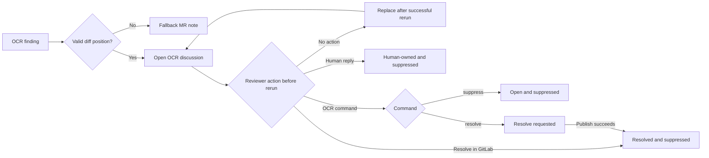

# GitLab review operations

For local Markdown artifacts and console output without forge acquisition or publication, use the
[standalone local review](local.md) provider.

This guide is for developers and CI operators who connect Open Code Review Toolkit to a GitLab merge-request pipeline and need to understand what happens after the first review. Installation and the [production bot recipes](gitlab.md#production-bot-configuration) remain in `gitlab.md`; the complete environment contract is in [configuration.md](configuration.md), and enriched acquisition is in [bounded review context](review-context.md).

OCR behavior below refers to the exact recommended release in the
[compatibility manifest](../compatibility/ocr-support.json) for this toolkit revision.

## What one review run publishes

The toolkit reads the previous OCR-owned notes and discussions before it writes anything. It fingerprints new findings, removes findings already owned or suppressed by reviewers, and publishes:

- inline GitLab discussions when a finding has a valid diff position;
- bounded fallback notes when GitLab cannot accept a position, for example after relevant lines moved outside the current diff;
- one `## Open Code Review` note whose single bold outcome line combines review health with the published, omitted, or reviewer-suppressed finding state; incomplete coverage and warnings remain explicit below it, with operational posting, commit, token/tool, and used-MCP metadata under a collapsed technical-details disclosure.

Category and severity belong to each individual finding, not to the review
outcome line. They use private-safe text labels by default. Operators may opt in
to static Shields.io images with `OCR_POST_BADGES=shields`; only closed,
normalized OCR enums enter the fixed-host URL and the same label remains as alt
text. If only one field is present, the image path uses an explicit `category`
or `severity` label rather than an ambiguous value-only badge. Unknown metadata never becomes a URL. Because rendering can contact an
external image service directly or through a GitLab proxy, keep text mode for
installations that must avoid that disclosure or dependency.

An actionable GitLab suggestion is stricter than an ordinary finding. The
toolkit reads the exact reviewed head blob and requires `existing_code` to
match the stated inclusive line range before it renders a replacement fence.
Publication DLP admits horizontal tab only in the `existing_code` and
`suggestion_code` fields; all other control/format characters remain blocking.
When the public projection is incomplete, posting preserves prior review state
and reports publication filtering separately from the original OCR coverage.
For this comparison CRLF and CR are normalized to LF and one optional terminal
newline is ignored. The replacement must describe one contiguous edit: a
fabricated ellipsis bridge, unified-diff-prefixed text, unsafe Markdown fence,
quick action, invalid range, or unavailable source suppresses only the
actionable fence. The explanatory finding remains visible with a bounded reason
that does not reproduce repository content. Exact no-op suggestions are also
suppressed.

`OCR_MAX_POST_COMMENTS` limits individually published findings. The default is 50 and the hard limit is 200. Omitted findings are counted in the summary rather than silently disappearing.

Publication reporting keeps three stages separate: OCR manifest coverage,
publication-DLP projection, and GitLab posting outcomes. A complete OCR run stays
complete when DLP omits a finding or field. Posting counts describe admitted
findings; DLP omission totals and their bounded overlapping source-class counts
are shown separately. Previous comments are preserved with the actual incomplete
stage reason instead of being replaced by a falsely clean review.

When a changed Git submodule pointer is safely separable under the qualified
OCR 1.13.3 executable, the toolkit reviews only the selected ordinary files.
The summary labels effective repository coverage **partial** and gives path-free
ordinary-file and changed-pointer counts. OCR's native `complete` manifest then
means only that its selected ordinary work completed. The pointer and submodule
contents remain unreviewed; the toolkit does not initialize or fetch a
submodule. No setting or MCP tool has to opt into this behavior. A partial
repository review cannot automatically approve, delete previous finding
threads, or resolve `/ocr resolve` discussions. Findings on skipped pointers
or files outside the selected ordinary set are rejected before publication.
If preview selects no ordinary files, `ocr-ci review` exits 2 without starting
the model; `ocr-ci post` publishes an advisory note with the same closed
coverage counts and exits 0, or 1 with `OCR_STRICT_POSTING=true`. Unsafe or
unqualified gitlink forms also stop before the model and never claim coverage.

`OCR_DLP_ENABLED` defaults to strict `true`. Exact `false` disables context,
federation and publication DLP for that run, emits a prominent warning in the
summary and Technical details, and makes automatic approval unreachable. It can
expose sensitive content through service/model egress or GitLab publication, and
the toolkit cannot retract prior egress or writes. Diagnose locally with
`--preserve-private-artifacts` before using it. Invalid or empty values fail before
OCR; non-DLP bounds, identity, evidence, cleanup and posting transaction gates
remain active.

`OCR_MAX_TOKENS_BUDGET` can set an aggregate input-plus-output token ceiling for the OCR diff review. The default `0` is unlimited. A positive ceiling is approximate rather than a hard billing cutoff because already-running work may complete; when it stops further dispatch, completed findings remain publishable and unreviewed files stay explicit as budget-attributed failed coverage. Such a run is partial and cannot automatically approve.

This aggregate budget is separate from both OCR's prompt/context `max_tokens` ceiling and the provider request's completion/output cap. The toolkit does not add an environment alias for OCR's prompt/context control. `OCR_LLM_MAX_COMPLETION_TOKENS` defaults to unset and, when set, overlays only the protocol-specific output field. The qualified inherited OpenAI value is 16,384, including grouping requests; [compatibility history](compatibility.md) records earlier values and their exact versions; an explicit toolkit override applies to all requests. A gateway may reserve cost against that requested maximum before generation even when the eventual response would be short. The `/models` capability value does not reveal an account spending limit or reservation policy, so the toolkit never selects the cap from it automatically. Set an explicit cap only from the deployment's provider/model contract when that deployment must not change with the qualified OCR version; the toolkit does not recommend or hardcode a provider-specific value.

`OCR_REVIEW_EFFORT=medium` is the toolkit default for the qualified OCR release and permits two review rounds; `low` permits one and `high` permits three. OCR multiplies its 15-minute subtask base by those rounds, yielding 15/30/45-minute limits; the GitLab example's 45-minute job timeout accommodates the largest preset. This is a review-depth choice, not one of the three token controls. OCR first groups related changed files and may make group-filter requests; additional rounds can add requests, latency, and cost, but may stop early when they add no finding. Below four changed files, OCR skips the grouping LLM: low total churn is bundled and high churn stays per-file. The published GitLab example separately passes `OCR_MAX_TOOLS=0`, selecting the embedded template default `100`. The CLI reports `1-49` as normalized to `50`, but both that target and explicit `50` remain effectively `100`; only values above `100` raise the cap. Exhausting the effective limit, an aggregate budget stop, or incomplete manifest coverage remains explicit and approval-ineligible; increasing either effort or tools is never a way to hide partial coverage.

The outcome wording distinguishes skipped, complete, complete-with-warnings, incomplete, token-budget, and failed reviews while preserving the finding state in that same line. A complete clean review is visibly positive; a complete review with findings or only reviewer-suppressed findings is neutral; warning, partial, budget, and failed states never look clean. Findings withheld by the posting limit remain counted even when the limit allows no individual finding note. Recommended focus areas ranks only its copy of already-published findings by the closed severity, category, safe repository location, and stable-identity order before its existing display cap; inline and fallback discussion order, suppression, counts, security focus, and approval policy remain unchanged. OCR manifest failures provide the canonical failed-file receipt; legacy warnings are a bounded fallback, and `summary.files_reviewed` is never treated as proof of successful coverage. Technical details label the aggregate as all OCR tool calls and retain the existing inline format while listing every admitted non-zero count for the closed native/context/evidence review set. An empty admitted list produces no tool-call line. The counts describe review activity, not per-tool token consumption: one read or search can return a different amount of context from another. Dynamic external tool names remain private; reconciled MCP-server attempt totals stay in their separate aggregate, and completed built-in evidence `summary`/`list`/`get` plus dedicated `search`/`coverage` counts appear only after action-receipt v3 accounts for every MCP-received or OCR-preparse attempted call. Failed and malformed attempts remain private, cannot appear as completed evidence, and cannot satisfy the mandatory summary. Zero completed action counters, unattributed attempts, queries, scopes, IDs, token counters, and configured-but-unused MCP servers are omitted. A present but incomplete or invalid receipt is rejected before prior comments are inspected or normal findings are published; an absent receipt selects the compatible direct-posting path only outside GitLab CI. Token usage renders only validated input/output/cached/reasoning/total/derived-other buckets; malformed or contradictory counters are unavailable and unknown provider keys are not published. Status and aggregate semantic-category emoji are enabled by default and can be disabled together with `OCR_POST_EMOJI=false`; finding labels remain text unless their separate badge mode is enabled.

When a fully validated receipt v11 records an actually unprotected target, the summary identifies its selected profile after the primary status line. `auto` says the target was unprotected, shows the captured protected policy anchor's full P SHA, and states that automatic approval was unavailable (comment-only); explicit `unprotected` retains *The target branch was not protected in GitLab. This review ran in limited, comment-only mode.* It appears without replacing or reclassifying clean, findings, warnings, partial, budget-stopped, failed-result, or publication-filtered outcomes. The limitation is a trust and approval boundary, not a coverage result. A protected target has no unprotected-target line; old, malformed, or contradictory receipts cannot assert the new protected authority.

## Current MR freshness

The v11 receipt keeps source H, current MR diff base/start/head/version, actual
target branch/T/protection, and selected policy project/branch/P/protection/mode
separate. Posting checks the authenticated current tuple before each current
result write, draft publication, old-note cleanup, and eligible approval. A
source move, retarget, changed target head or protection, or changed diff
identity makes the captured code review stale. It does not replace the earlier
valid review or reconcile its notes as though the old result described the new
MR tuple. Missing or contradictory provider data fails closed with an
unavailable/stale outcome; a valid empty diff is different from missing diff
data.

For `auto` with an unprotected actual target, the same still-protected default
policy branch may advance normally after P was captured, if bounded isolated Git
proves P is an ancestor of its new head. A shallow graph gets one bounded
depth-128 history fetch before the proof is retried. The completed review
remains bound to captured P and does not claim that P is latest. A changed
default selection, lost protection, replaced authority, non-fast-forward
rewrite, or ancestry that still cannot be proved stops publication.
A protected actual target is also its own code target, so its advancement makes
the code tuple stale. These pre-write reads cannot eliminate a provider-side
race between validation and mutation.
After GitLab publishes a draft, its draft ID does not prove the identity of the
visible note for rollback. A change detected mid-publication stops later writes
and returns a visible failure, but already published current-run notes may remain
beside the preserved previous review. GitLab's current state and its approval
reset policy remain authoritative.

## Automatic approval lifecycle

`OCR_AUTO_APPROVE=true` is the default. Approval is a separate transaction only
after every current review note publishes. A review is eligible only with exact closed receipt v11 for a protected actual target, enabled DLP, a supported complete manifest, no warnings, failures, waivers, token-budget stop, or omitted findings, no used advisory federation tool or uncertain federation accounting, no degraded metadata, no DLP-rejected selected source, no required context degradation, no admitted remediation context, and at most three findings. Receipt v9/v10 remains readable for historical diagnostics under its original policy-equals-target invariant, but cannot publish or approve a new current review; v1-v8 remains unsupported. Receipt v11 binds the current MR diff and source H, actual target T/protection, selected policy authority P/protection, merge-request author ID, context mode/state, DLP mode, per-source completeness/degradation, admitted-mutable state, fixed context-tool use, mandatory evidence state, content-free federation reconciliation, stage-aware publication DLP, and cleanup. An actually unprotected target is structurally ineligible: orchestration does not call the approval executor, regardless of `OCR_AUTO_APPROVE` or whether the policy authority is protected. Unused federation services and successful `review_read` use do not independently block approval for protected targets. `private-sanitized` remains eligible only when its canonical publication/approval projection is byte-equivalent; `publication-filtered` is partial and ineligible. Complete `metadata` context, complete non-remediation enrichment, and the built-in evidence/context MCP do not independently block approval on a protected target. Every finding must have
severity exactly `low` and category exactly `style`, `documentation`, or
`maintainability`. A complete zero-finding review is eligible. Four findings,
malformed metadata, or any other severity/category are not eligible.

Before writing, the toolkit repeats the [current-MR freshness check](#current-mr-freshness) for source H, target branch/T/protection, diff base/start/head/version, and policy branch/P/protection. It also requires an open MR, the same positive author ID, `detailed_merge_status` outside `checking` and `approvals_syncing`, and a non-null `patch_id_sha`. If the authenticated toolkit user is that author, self-approval is skipped without a write. Otherwise it passes the exact reviewed H to GitLab's approve API and confirms the authenticated user, exact SHA, and unchanged non-bot author in post-write approval readback. A moved or unverifiable identity before the write skips approval; a post-write mismatch fails closed and leaves GitLab's existing approval state untouched.

Approve and summary-update writes are not retried after timeout, connection
loss, 5xx, or another ambiguous response. GitLab remains
authoritative for eligible approvers, required groups, Code Owners,
protected-branch rules, and password or SAML reauthentication. A provider
rejection or ordinary approval-management failure does not retract an already
published advisory review. A stale or unverifiable identity before the approval
write stops the current publication, preserves the previous review, and returns
nonzero; published draft notes may remain visible because the draft publication
response does not establish their visible-note IDs.

The summary records exactly one bounded state: `approved`, `not eligible`,
`disabled`, `skipped`, or `failed`. With advisory `OCR_STRICT_POSTING=false`, an
ordinary approval-management failure leaves the published review successful but
visibly failed; with `OCR_STRICT_POSTING=true`, it also returns a nonzero exit
code. Identity drift and uncertain current publication return nonzero in either
mode.

The transaction is deliberately add-only because GitLab's unapprove endpoint
cannot bind removal to an immutable reviewed SHA at mutation time. The toolkit
therefore never removes an existing approval, even when the authenticated bot
user approved earlier. An unprotected-target or retargeted MR receives no new
approval from that run, but a prior approval can remain visible depending on
GitLab's reset settings; it does not authorize the new tuple. Ineligible,
partial, skipped, older-receipt, and disabled runs do not make an approval write.
Configure GitLab's project-owned reset or invalidation policy when approvals
must be withdrawn after commits or retargeting. Human discussion replies remain
ownership boundaries for notes but do not independently block approval.

## Discussion lifecycle

If posting fails, the transition does not complete: the previous review and every human-owned, suppressed, or resolve-requested discussion keep their prior state. Matching findings remain suppressed on later runs.

An untouched open OCR discussion is bot-owned. A successful rerun replaces bot-owned notes with the current review instead of accumulating stale copies. Once a person replies, the discussion becomes human-owned: the toolkit preserves the complete conversation and suppresses a finding at the recorded inline position or with a compatible fingerprint.

A discussion resolved with GitLab's normal Resolve action is also preserved and suppresses a matching future finding. The toolkit never reopens a discussion.

## Reviewer commands

Reply inside an OCR-created discussion with exactly one command. Commands are case-insensitive, but the whole reply must contain only the command and optional surrounding whitespace. A command inside prose or a code block is ignored. If reviewers post several recognized commands, the newest one wins. Bot and GitLab system notes cannot issue commands.

| Command | Discussion after the command | Matching finding on future runs |
| --- | --- | --- |
| `/ocr suppress` or `@<live-bot-username> suppress` | Remains open | Suppressed |
| `/ocr resolve` or `@<live-bot-username> resolve` | Resolved after the next successful posting transaction | Suppressed |
| Ordinary human reply | Remains in its current state and becomes human-owned | Matching position or fingerprint suppressed |
| GitLab Resolve action | Resolved | Suppressed |

The mention form uses the username returned by authenticated `GET /user`; no configured username is trusted. A GitLab username may contain punctuation, so a bot named `mr.bot` accepts the exact reply `@mr.bot resolve`. A typo such as `supress`, a different mention, or `@mr.bot retest` is not a lifecycle command.

The command is applied when the next pipeline reads the discussion. `/ocr resolve` and its mention equivalent wait until all notes created for the current review have published successfully before resolving the old discussion. A failed run therefore does not close it prematurely. The toolkit does not receive comment events, so use GitLab's retry UI/API for a no-commit rerun; a comment-triggered rerun requires a separately deployed Note Hook receiver.

`/ocr keep` and `/ocr skip` were removed in 0.2.0 and are not aliases. An existing reply containing an old command still counts as an ordinary human reply: its conversation is preserved and matching future findings remain suppressed, but it does not request automatic resolution.

## Will OCR report the same bug again?

Every OCR note contains an invisible toolkit marker and a stable finding fingerprint. The current fingerprint combines the repository path, normalized finding text, and the existing-code fragment when OCR supplies one. This lets suppression survive an ordinary line shift. Backward-compatible fingerprints keep review decisions made by earlier toolkit versions usable.

Suppression checks both the recorded inline position and compatible fingerprints. A new finding anchored to the same recorded path and line is suppressed even if its text changes; elsewhere, the fingerprint prevents ordinary line movement from bypassing the decision. Suppression is intentionally not a permanent rule for an entire file: a materially different explanation, code fragment, path, or duplicate occurrence at another location can become a new finding and receive a new discussion. When identical findings occur more than once, occurrence-aware fingerprints prevent suppressing every occurrence after a reviewer acts on only one of them.

## Posting modes and blocking behavior

`OCR_POST_MODE=draft` is the safe default. Every position-bearing inline create receives a separate cryptographically random write marker before `POST /draft_notes`. A valid success records the returned positive draft ID. If the one create is ambiguous, the toolkit performs one complete bounded author-bound `/draft_notes` read and recovers only exactly one matching marker/ID; zero, multiple, foreign, malformed, unavailable, or incomplete results cause no retry and no fallback. Current-run draft IDs are published exactly once, and replaceable notes from the previous successful review are removed only after every publish succeeds. Draft mode avoids exposing an incomplete review during creation, but GitLab does not provide atomic bulk publication.

`OCR_POST_MODE=direct` is an emergency compatibility override. Position-bearing `POST /discussions` uses the same independent marker and one complete bounded reconciliation read after ambiguity. Recovery requires exactly one toolkit-owned note with the expected author, positive note ID, and bounded discussion ID. Explicit current-run discussion identities participate in rollback; marker-only global rescans do not. Direct mode remains non-atomic, so prefer `draft` for normal CI.

`OCR_STRICT_POSTING=false` is the advisory default for eligible posting outcomes and authenticated static statuses. Errors without a provably current review identity, invalid results, stale identities, and ambiguous draft publication return nonzero even in advisory mode and remain visible in the job log. Set `OCR_STRICT_POSTING=true` when OCR review is a required merge gate so eligible posting or approval-management failures also make the job fail.

## OCR diagnostics

When required evidence use is not confirmed, the review is rejected before publication or automatic approval. The console emits `Review rejected:` with the stable reason `evidence-use-unconfirmed`, an explicitly reported zero or `unavailable`, and validated outcome/manifest coverage counts where present. A positive primary count with unconfirmed completed summary attribution uses `evidence-action-attribution-invalid`. Malformed telemetry remains a separate integrity error. These facts do not establish whether the model omitted a call or OCR omitted attribution; successful MCP preflight establishes readiness and never supplies model-use evidence.

Safe rejection facts appear before result cleanup in local and CI execution. An advisory green job does not mean the review was accepted. Authorized `--preserve-private-artifacts` runs still enforce the evidence gate: bounded rejected JSON is retained in an owner-only private diagnostic envelope, with no successful receipt, report, or approval authority. Retention failure keeps the original rejection and removes the unsafe handoff. All retained diagnostic results carry `_ocr_toolkit_private_diagnostic`; posting refuses this marker even when no provider receipt is present. GitLab MR execution continues to reject private retention. Inspect retained material only locally and do not upload it as a public CI artifact.

OCR's optional failed-tool `arguments` are validated only for type and bounds and
discarded before normalized diagnostics and publication DLP. Private arguments
alone do not change the GitLab summary or DLP counters. Malformed diagnostics
preserve valid review signal; genuine DLP failures in public fields still filter
those fields and leave a safe summary. Raw OCR stderr remains private. See the
[diagnostic decision flow](review-decision-flow.md#additive-failed-tool-diagnostic-states).

Receipt v11 is emitted only for a validated GitLab merge-request profile with a real `protected|unprotected` target observation. An ordinary local review still receives the same result parsing, evidence/federation reconciliation, and publication DLP, but remains receipt-less because local Git state cannot establish GitLab protection. The compatible standalone receipt-less posting path outside GitLab CI remains approval-ineligible and cannot render receipt-derived federation or target-protection claims; a CI result without v11 and any present malformed or incomplete receipt fail closed before prior review state is read.

Run OCR through `ocr-ci review --result PATH --stderr PATH -- ...`. The wrapper owns preview, one OCR model loop, mandatory evidence, governed federation lifecycle, result validation, stage-aware DLP, cleanup and receipt v11. It does not post to GitLab. A recognized soft background diagnostic is attached after publication DLP and rendered only with an exact receipt; hard rejection stops before the model. Cleanup or federation-receipt uncertainty blocks normal publication. DLP-filtered findings and fields are omitted without relabelling original OCR coverage; previous comments remain and the `ocr.publication-dlp-signal/v4` marker reports only closed public omission, private sanitization and source-class counts. Posting never reconstructs or republishes rejected values. Historical v3 signals contain aggregate fields whose public/private split cannot be recovered.

HTML-like syntax in optional `existing_code` or `suggestion_code` is admitted
only when the exact code is proved against the immutable reviewed head and
safe code rendering applies. Secret, PII, forbidden-value and other DLP
checks still apply. Unproved code and ordinary prose keep the stricter HTML
rule; a rejected optional field can be omitted while safe findings survive.

OCR may add group labels, file membership, grouping-task records, round diagnostics, readable reasoning, and provider-native replay payloads to private session data. They remain outside the canonical finding/posting projection, receipt v11, DLP counts, toolkit telemetry, tool/token summary, and approval inputs. If they appear inside receipt v11, validation fails closed. Caller `--output`/`-o` is rejected before preview because the wrapper owns the result descriptor and posting handoff.

When OCR exits nonzero with a valid bounded `ocr.llm-retry-report/v1`, the toolkit reads only its closed error class, failure phase, terminal outcome, HTTP status, and schema counters. It maps those facts to `authentication`, `authorization`, `rate-or-spending-limit`, `overloaded`, `timeout`, `network`, `endpoint-or-model-not-found`, `request-rejected`, `provider-unavailable`, `invalid-response`, `cancelled`, `mixed`, or `unknown`, then reports the classification in the job. A nonzero OCR run has no authenticated full B/H/T/P posting receipt, so it does not create a potentially stale MR failure note. A runtime `404` remains `endpoint-or-model-not-found` because safely distinguishing the endpoint from the model would require trusting the raw response body.

The review step emits at most one numeric line beginning `OCR provider diagnostics:`. It distinguishes HTTP `402` as `http-payment-required` and `429` as `http-rate-limited`, includes a shared bounded status only when every terminal failure has that status, and includes only non-zero failed, cancelled, retried, total-retry, and recovered request counters. Mixed terminal details are sorted and count-aggregated rather than emitted per request. These protocol facts do not prove ordinary throttling, a spending policy, or cost reservation from the requested output cap. The line is local operator feedback, not toolkit telemetry, a receipt field, a DLP input, a GitLab summary field, or an approval signal.

The `rate-or-spending-limit` job guidance keeps that intentionally broad reason and suggests lowering `OCR_REVIEW_CONCURRENCY` and/or `OCR_LLM_MAX_COMPLETION_TOKENS`, starting a new merge request pipeline, and then checking provider request/account limits if the failure persists. Neither setting is presented as the proven cause.

Raw provider/model identities, response bodies, error codes and messages, request IDs, paths, warnings, and stderr remain in owner-only private artifacts for a classified provider failure. Normal findings from the failed result are ignored, the previous successful review is preserved, and automatic approval is not attempted. Missing, oversized, malformed, or internally contradictory retry reports keep the generic job-local failure path instead of guessing a classification.

For a local diagnosis, add `--preserve-private-artifacts` before the `--` separator. The command retains owner-only private review material and deliberately leaves no posting-eligible receipt. Inspect it locally before considering `OCR_DLP_ENABLED=false`, keep it out of commits and shared artifacts, and remove it afterward. The escape hatch can expose sensitive content through service/model egress, local Markdown or GitLab and cannot retract prior disclosure.

The next admitted review in a checkout clears an earlier private status before
runtime configuration validation, so an early failure cannot hand the previous
run's status to `post`. A private nonblocking lock prevents concurrent reviews
in one checkout from sharing or deleting each other's fixed artifacts. If a
review cannot claim that lock or safely clear prior status, it returns code
`75`. The paired `post` step then stops before reading private state or GitLab
configuration, preserving any status owned by the concurrent or earlier run.
Receipt v11 and note-capable status also carry GitLab's `CI_JOB_ID` when supplied;
`post` rejects another job's result or status even if B/H/T/P are unchanged.
The public GitLab example uses job-specific result and stderr paths. Run one
review/post pair per CI job; separate checkout and output paths are required for
independent pairs in a shared workspace.

The `ocr.pre-execution-status/v5` records a closed stage and `model_execution=not_started` for recognized stops. A changed gitlink stops preview qualification before model review; ordinary files are not reviewed in that run. Unclassified preview diagnostics retain only a bounded count, never raw stderr or content. Statuses that can post a note carry the authenticated review identity; posting revalidates the exact MR diff, target and policy before each write. Setup-pending additionally requires the captured policy SHA because a newer policy may already contain the missing rule. Unproven identity remains in the job only. A stale reviewed revision is reported only in the old job and never posts a note to the newer revision.

Pre-execution outcomes have narrower static reporting. When the merge request introduces the configured repository-owned OCR rules path and that exact path is absent from both immutable policy-side baselines, `review` verifies only that the source object is a bounded regular blob, writes a closed private status, and stops before OCR. When installed OCR rejects the generated background during preview, the status instead carries the closed character/file-size reason plus actual, limit, and unit. When the exact identity-bound GitLab merge request is already `merged` or `closed`, the toolkit stops before evidence collection and OCR, then upserts one toolkit-owned plain status note. `post` hostile-validates the v5 status against the current source and diff-base identities; note-capable statuses also carry the full authenticated MR review tuple for live B/H/T/P revalidation, while the terminal variant checks the exact provider/project/MR target. Every non-strict success path re-reads that exact lifecycle before returning; a reopened, unavailable, unknown, or mismatched MR fails and requires a new review even when note collection or verification also failed. A `merged` MR is irreversible and may return success after exact note readback. A `closed` MR remains reopenable: advisory mode may report the expected skip successfully, but `OCR_STRICT_POSTING=true` keeps the required gate nonzero so reopening cannot reuse a green no-review result. The terminal note states that no model ran, no findings were produced, approval was not attempted, and prior review/reviewer state remains intact. Duplicate jobs update the same note; an ambiguous or multiply matched note fails closed. The terminal marker is control metadata only in its reserved preamble line, so marker-like finding text cannot select, overwrite, or delete a review note. A successful ordinary result removes a stale terminal note only after publication succeeds, including safe partial publication.

For an admitted receipt-v11 result, `post` re-reads the exact current MR identity and lifecycle before each current-result write and cleanup step. `opened` keeps ordinary behavior. If that MR became `merged` or `closed` after review, v11 posting stops further normal publication and approval while preserving the previous valid review. The separate pre-execution terminal-status path can still emit its own static note when review began on a terminal MR. Malformed, unknown, unavailable, or identity-mismatched lifecycle data stops publication. Already visible notes from an interrupted transaction may require operator cleanup because GitLab does not offer an atomic multi-note commit or a draft-ID-to-visible-note rollback guarantee.

A successful retry replaces only an earlier toolkit-owned setup-pending note; background rejection and job-local generic failures never replace previous review findings or summaries. Static outcomes include no rules/background path or raw stderr and trust no repository/provider display text. A present malformed, stale, unsafe, unknown, or identity-mismatched private status stops posting without a new note. `OCR_POST_EMOJI=false` removes the heading emoji.

The setup-pending case is the supported one-merge-request installation path, not a completed review. Retrying the same merge request does not help because the captured protected policy commit still lacks Rules; merge the setup change and use a later merge request. In detached pipelines, the recognized note uses the same validated source H as execution: `CI_COMMIT_SHA` must match the authenticated current MR source, and any populated MR-specific source SHA must agree. Synthetic merge-result, merge-train, missing, and contradictory event identities cannot supply H. An identity or status mismatch stays in the job and preserves the previous review. A green advisory job still does not prove OCR/model execution; require a valid result, complete manifest coverage where expected, reconciled receipt/action counts, and the published review state.

## GitLab identity and permissions

Use a dedicated project access token with `api` scope and at least the Developer role. Store it in `GITLAB_API_TOKEN`. The toolkit needs to read merge-request notes, discussions, diff refs, approval state, and the current token identity; create and delete its own notes or drafts; publish drafts; resolve discussions requested by reviewers; and, unless opted out, approve as that dedicated identity. GitLab must separately consider the identity eligible under the project's approval rules.

The toolkit calls `GET /user` before posting and refuses to write if it cannot identify the token owner. It treats a note as bot-owned only when both the invisible OCR marker and the actual GitLab author ID match, and uses the same validated live identity's username for mention commands. Text that merely imitates an OCR marker is not enough to claim or delete another user's note.

## Reruns, failures, and fallback notes

Before a rerun, the toolkit takes a complete bounded snapshot of OCR-owned notes, discussions, and drafts. If it cannot collect that state reliably, it refuses to publish a replacement so resolved, suppressed, and human-owned decisions are not lost. Reads and writes have bounded response sizes and timeouts; non-idempotent creates are never blindly retried.

For position-bearing inline creates, outcomes are closed: `posted`, `invalid_position`, `definite_failure`, or `ambiguous_create`. Only `invalid_position` may enter bounded fallback. An ambiguous create receives one complete endpoint-specific marker/author readback; unresolved ambiguity causes no retry and no fallback. Regular notes/drafts, updates, deletes, resolve, draft publication, and approval do not gain reconciliation or retry behavior.

The previous review is deleted only after the new review has been created and, in draft mode, published. Explicit provider-returned or reconciled current-run identities drive rollback, guarded by the complete pre-run ID baseline; the toolkit never infers rollback ownership from a marker-only global rescan. An ambiguous draft-publish failure still does not delete possibly published notes because the runner cannot prove which drafts became visible. After a partial or unconfirmed draft publication, it attempts to remove only current-run drafts whose publish request was never attempted; an unconfirmed cleanup is reported, and pending drafts never count as already published findings on the next filtered run.

Before old-review cleanup begins, a stale current identity stops publication and preserves the old review; direct current-run notes can then be rolled back. After any old-note deletion or resolution is attempted, a later stale identity or unconfirmed provider response stops further cleanup with a nonzero outcome and keeps current-run comments. This also applies to setup-pending replacement notes. The old state may be partial, so this path reports partial cleanup rather than claiming the previous review was preserved.

Source and base merge-request SHAs define the reviewed range. A merge-result commit is not treated as the source branch head. The summary records the reviewed SHA and warns when the current MR head has moved, so reviewers can distinguish a current review from a stale pipeline result.
