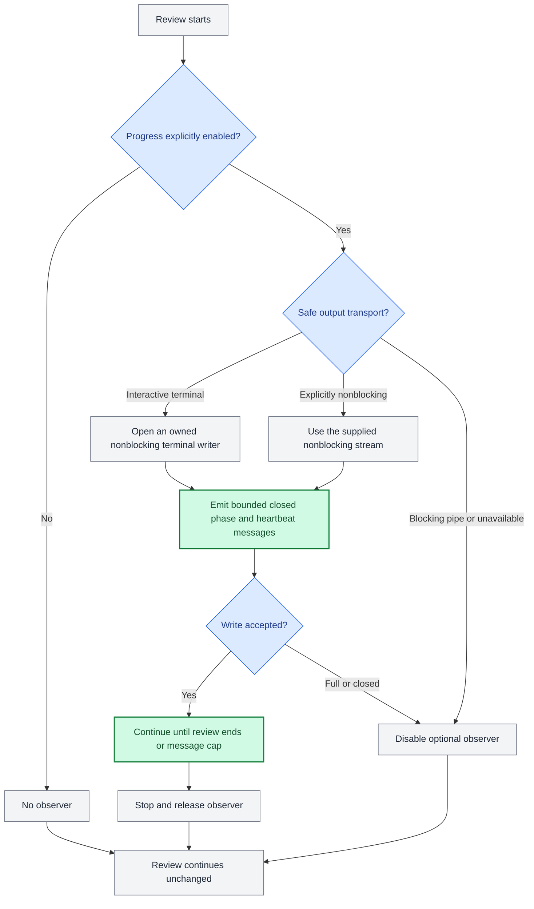
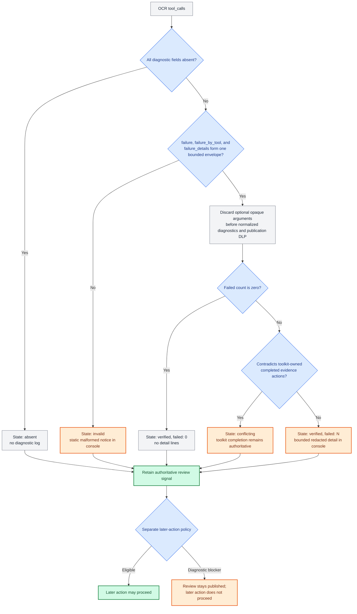
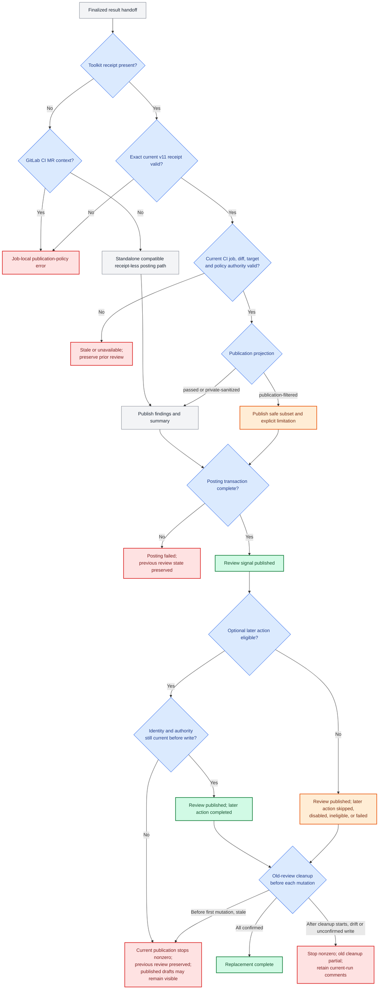

# Review decision flow

With `review --local --debug-dir`, a private observer records these same checks;
it does not add an execution or admission branch. Raw output is captured before
finalization, safe output only after admission, and the journal records cleanup
and successful or failed report delivery. See [local debug bundles](local.md#private-debug-bundle)
for bounds, missing artifacts and incomplete journal semantics. Local report and
debug delivery pin their private parent directory before creating entries, so a
same-user replacement of a visible ancestor cannot redirect a retained artifact.

This document is the canonical visual map of the toolkit's end-to-end review decisions. It
connects configuration and immutable identity, OCR execution, result and action-receipt
validation, additive diagnostics, publication DLP, GitLab posting, and optional later actions.
The shorter diagrams in [the toolkit strategy](engineering/toolkit_strategy.md) remain
architecture overviews; this document owns the detailed operational branches.

The diagrams describe toolkit decisions, not OCR finding quality or GitLab merge policy. The
executable authorities remain the runtime validators and their contract tests. If this map and
an executable contract disagree, the change is incomplete: update the implementation, tests,
and every affected public contract together before release.

## Color legend

| Color | Meaning |
| --- | --- |
| Green | Successful terminal state: the intended review signal was retained or published. |
| Orange | Warning terminal state: useful signal survived, but completeness or a later action is limited. |
| Red | Error terminal state: the current stage stopped and must not claim successful publication. |
| Gray | Auxiliary or neutral state: input, processing step, or an intentional non-publication path. |
| Blue | Decision or validation boundary. |

The same palette is repeated in every diagram so a terminal state never changes meaning between
views.

## Optional progress observer

`OCR_REVIEW_PROGRESS` is an observer, not an input to OCR or an execution gate.
It can emit only closed toolkit phase labels and never reads review content,
artifacts, or session state. A conventional GitLab stderr job-log pipe remains a
valid review transport but is not a valid optional-progress transport: the
observer stops instead of risking a blocked review or changing the caller-owned
file-descriptor flags.

## End-to-end control flow

Local execution preserves the configured API provider by default. Optional
`OCR_LLM_AUTH_MODE=chatgpt` selects native OCR authentication only with explicit
`--local`; the GitLab path rejects it before native-store access. Its preflight
checks structural readiness, while OCR owns grant/expiry validation on use.
Neither preflight nor review initiates login or falls back to another provider.

```mermaid
flowchart TD
    start[CI or local review request] --> auth{Explicit local ChatGPT mode?}
    auth -- No --> api[Use configured API provider]
    auth -- Yes --> local_auth{Local profile, qualified binary,<br/>native store and config valid?}
    local_auth -- No --> preflight_error[Review blocked before OCR]
    local_auth -- Yes --> native_auth[Isolate runtime config; link only native auth;<br/>OCR owns grant checks and refresh]
    api --> input{Configuration, immutable refs,<br/>target state, and paths valid?}
    native_auth --> input
    input -- No --> preflight_error
    input -- Yes --> profile{Local or GitLab MR?}
    profile -- Local --> acquire
    profile -- GitLab MR --> detached{Detached pipeline and<br/>checked-out source H?}
    detached -- No --> preflight_error
    detached -- Yes --> initial_state{Same-project MR identity<br/>and lifecycle valid?}
    initial_state -- Invalid --> preflight_error
    initial_state -- Merged or closed --> terminal_route[Upsert expected terminal status;<br/>no evidence, OCR, findings, or approval]
    terminal_route --> terminal_gate{Closed with strict posting?}
    terminal_gate -- Yes --> terminal_strict_error[Required gate nonzero;<br/>a reopened MR needs a new review]
    terminal_gate -- No --> terminal_note[Advisory terminal skip complete]
    initial_state -- Open --> current_diff{Current MR diff base/start/<br/>head/version and target valid?}
    current_diff -- No --> preflight_error
    current_diff -- Yes --> protected{Actual target protected?}
    protected -- Yes --> target_policy[Use captured target T as policy P]
    protected -- No --> selector{Protection mode?}
    selector -- required --> preflight_error
    selector -- unprotected --> limited{Limited context and<br/>no federation?}
    limited -- No --> preflight_error
    limited -- Yes --> unprotected_rules[Read T Rules only as<br/>untrusted guidance]
    selector -- auto --> default_policy{Same-project default branch<br/>exists and is protected?}
    default_policy -- No --> preflight_error
    default_policy -- Yes --> separate_policy[Capture default policy P<br/>separate from actual target T]
    target_policy --> acquire[Collect bounded immutable evidence<br/>and optional authorized context]
    unprotected_rules --> acquire
    separate_policy --> acquire
    acquire --> registry[Parse registry v2; freeze schemas/tools;<br/>start bounded federation gateway]
    registry --> acquire_ok{Mandatory evidence, context, and<br/>federation readiness valid?}
    acquire_ok -- No --> preflight_error
    acquire_ok -- Yes --> gitlink_check{Changed gitlink?}
    gitlink_check -- Yes --> gitlink[Closed gitlink status;<br/>model not started; ordinary files not reviewed]
    gitlink_check -- No --> preview[Run exact OCR preview with<br/>toolkit-owned child environment]
    preview --> preview_ok{Preview accepted?}
    preview_ok -- Unclassified diagnostics --> preview_unclassified[Closed stage/count status;<br/>model not started]
    preview_ok -- Other failure --> preview_error[OCR not started; bounded failure path]
    preview_ok -- Yes --> review[Run OCR against exact from/to refs<br/>with internal MCP plus fixed relay;<br/>guide summary and direct MR intent read,<br/>then relevant allowlisted tools when useful]
    review --> exit{Review exit code}
    exit -- No private handoff (75) --> no_handoff[Job-only failure;<br/>do not read another run's status or contact GitLab]
    exit -- Non-zero --> runtime_error[No normal result publication;<br/>failure remains in job without full review identity]
    exit -- Zero --> finalize[Enter result finalization]
    finalize --> core{Result, manifest, identity, cleanup,<br/>action receipt and federation receipt valid?}
    core -- No --> rejection_diag[Emit bounded rejection facts;<br/>zero vs unavailable; fixed reason code]
    rejection_diag --> retain_rejected{Authorized local private retention?}
    retain_rejected -- No --> integrity_error[Delete unsafe handoff;<br/>normal publication blocked]
    retain_rejected -- Yes --> retained_rejected[Owner-only bounded diagnostic envelope;<br/>no receipt, successful report or posting authority]
    core -- Yes --> diag[Classify additive failed-tool diagnostics]
    diag --> dlp_mode{OCR_DLP_ENABLED?}
    dlp_mode -- true --> dlp[Apply source-proofed code exception,<br/>publication and private-field DLP]
    dlp_mode -- false --> disabled[Keep prominent risk warning;<br/>force comment-only]
    disabled --> publishable
    dlp --> dlp_state{DLP state}
    dlp_state -- passed --> publishable[Complete publishable projection]
    dlp_state -- private-sanitized --> publishable
    dlp_state -- publication-filtered --> partial[Safe partial projection;<br/>original coverage remains explicit]
    publishable --> mode{Execution profile}
    partial --> mode
    mode -- Local diagnostic retention --> local[Owner-only artifacts retained;<br/>no provider receipt or posting authority]
    mode -- Local ordinary --> local_result[Validated receipt-less local result]
    local_result --> local_output{Explicit local provider?}
    local_output -- Yes --> local_file[Shared admitted summary and all findings<br/>to fresh private Markdown artifact and console]
    local_file --> local_delivery{Artifact and console delivery succeed?}
    local_delivery -- Yes --> local_done[Local delivery complete;<br/>no platform actions]
    local_delivery -- No --> local_error[Nonzero delivery failure;<br/>preserve any completed artifact]
    runtime_error -- Explicit local --> local_failure[Closed failure summary to console;<br/>artifact if destination was accepted]
    integrity_error -- Explicit local --> local_failure
    local_output -- No --> local_handoff[Private JSON handoff only]
    mode -- GitLab MR --> receipt[Attach exact receipt v11:<br/>diff, target T, policy P and CI job]
    receipt --> post{Posting input valid at readback?}
    retained_rejected --> posting_error
    post -- No --> posting_error[Job-local publication-policy error;<br/>findings transaction not started]
    post -- Yes --> live_state{Current MR diff, target T,<br/>policy P and lifecycle valid?}
    live_state -- Invalid, moved or terminal --> posting_error
    live_state -- Open --> transaction[Publish current findings and summary<br/>with bounded readback and rollback]
    transaction --> transaction_ok{All required writes succeed?}
    transaction_ok -- No --> posting_error
    transaction_ok -- Yes --> published{Projection complete?}
    published -- Yes --> success[Review signal published]
    published -- Safe partial --> warning[Safe review subset published;<br/>not a complete public review]

    classDef success fill:#d1fae5,stroke:#15803d,color:#14532d,stroke-width:2px;
    classDef warning fill:#ffedd5,stroke:#ea580c,color:#7c2d12,stroke-width:2px;
    classDef error fill:#fee2e2,stroke:#dc2626,color:#7f1d1d,stroke-width:2px;
    classDef auxiliary fill:#f3f4f6,stroke:#6b7280,color:#1f2937;
    classDef decision fill:#dbeafe,stroke:#2563eb,color:#1e3a8a;

    class success,local_result,terminal_note success;
    class warning warning;
    class local auxiliary;
    class preflight_error,terminal_strict_error,preview_error,gitlink,preview_unclassified,no_handoff,runtime_error,integrity_error,posting_error error;
    class start,api,native_auth,terminal_route,target_policy,unprotected_rules,separate_policy,acquire,registry,preview,review,finalize,diag,dlp,disabled,publishable,partial,receipt,transaction auxiliary;
    class auth,local_auth,input,profile,detached,initial_state,terminal_gate,current_diff,protected,selector,limited,default_policy,acquire_ok,gitlink_check,preview_ok,exit,core,dlp_mode,dlp_state,mode,post,live_state,transaction_ok,published decision;
```

Recognized stops record an identity-bound `ocr.pre-execution-status/v5` with a closed
stage and `model_execution=not_started`. A stale merge-request revision is
reported only in the old job's local output; it never posts into the newer
merge request. A changed gitlink stops preview qualification before model
review. Note-capable setup and preview statuses carry the complete authenticated
B/H/T/P identity for live revalidation before each write; setup also requires
the exact captured P. Unclassified preview diagnostics retain only a bounded
count, never raw stderr. Generic OCR, parse, schema and provider failures
without a posting-eligible full identity remain in the job. A v11 result whose
MR becomes terminal before posting does not publish a new normal review; the
pre-execution terminal-status note is a separate path.

Evidence keeps the reviewed `B..H` delta, the actual target T, and the selected
policy commit P distinct. The optional bounded `ref=target` snapshot exposes
untrusted file metadata and dependency facts for relevant changed paths at T;
it cannot supply Rules, guidance, decisions, a second delta, or an absence
proof. Local review has no GitLab target snapshot.

Source-bound `existing_code` and `suggestion_code` may contain HTML-like syntax
only after exact immutable reviewed-head proof and safe code rendering. Other
publication text and unproved code retain the ordinary HTML restriction; all
code still crosses the remaining secret, PII, forbidden-value and control
checks. Publication `ocr.publication/v2` separates public omitted fields and
reasons from private-only sanitized fields and reasons. The v4 summary signal
and receipt v11 expose those closed counts without converting OCR coverage or
provider posting counts.

The core integrity boundary deliberately precedes additive diagnostics. A malformed result,
contradictory manifest, stale identity, failed cleanup, or missing/mismatched toolkit action
receipt blocks finalization. Mandatory evidence rejection emits safe facts before cleanup; authorized local diagnostic retention preserves a bounded private envelope, while its marker blocks even receipt-less posting. Failed diagnostic retention never replaces the original rejection. By contrast, OCR's additive failed-tool envelope is diagnostic: it
cannot replace an otherwise valid manifest, findings, summary, or posting transaction.

## Additive failed-tool diagnostic states

Valid detail records are bounded, credential-redacted, and control-safe before they reach the
local stderr or CI job log. Dynamic detail text, paths, and per-tool failure maps never enter the
finalized result, receipt, merge-request comments, publication-DLP telemetry, or later-action
inputs. Receipt v11 stores only `absent|verified|invalid|conflicting` and a bounded aggregate
`failed` integer for `verified`; the toolkit action receipt v3 remains authoritative for evidence
attempts and completions.

The optional raw `arguments` string is bounded to 32768 characters and 131072
UTF-8 bytes, then discarded rather than rendered. Its private content alone cannot
change publication-DLP counters, review status, findings, or summary text. Invalid
arguments make the additive diagnostic envelope invalid while retaining the review
signal. Public findings, warnings and suggestions still pass the full DLP checks.
Raw OCR stderr can contain arguments and stays private. A recovered comment batch
keeps its ordinary repair warning; neither repair nor diagnostic failure controls
summary publication through the later-action branch.

This separation applies in every execution profile. It is not a local-mode exception and it is
not an automatic-approval feature: publication owns review-signal delivery, while any later action
evaluates the already-published result independently.

## Posting and later-action states

The current GitLab later action is an optional receipt-bound approval write. It is only one
consumer of the finalized state. Unprotected targets, disabled DLP, incomplete coverage,
publication filtering, non-zero or uncertain tool diagnostics, context blockers, used advisory
federation tools or uncertain federation accounting, identity movement, and
other documented gates can make that action unavailable without turning a successfully published
review into a failure. GitLab approval rules, Code Owners, protected-branch policy, and mergeability
remain external merge-policy authorities.

For a current GitLab review, `auto` selects protected default P only after the
actual target T is authenticated as unprotected; explicit `required` rejects T
and explicit `unprotected` retains its limited path. B is the current MR diff
base, H its source head, and `B != T` is valid. The code tuple and authority are
checked before each current-result write and again before an eligible approval. A policy-only
fast-forward of the same still-protected default branch may finish against
captured P when ancestry is proved; a changed default, lost protection, rewrite,
unverifiable ancestry, or moved code tuple stops. Exact v9/v10 receipts remain
historically readable under their original invariants but cannot authorize a
new current publication. A detached GitLab CI job without v11 cannot use the
standalone direct-posting path; local review stays receipt-less and does not post
to GitLab. Pre-write checks leave a provider-side race; neither the diagram nor a comment-only
outcome implies that an earlier bot approval was revoked.

## Maintenance contract

Update this document in the same change whenever any of these boundaries changes:

- review preflight, immutable identity, target-protection, OCR preview, or child environment;
- result/manifest parsing, action receipt, receipt schema, cleanup, or DLP projection;
- diagnostic parsing or any console, result, receipt, summary, comment, or telemetry sink;
- posting transaction ordering, partial-publication behavior, or a later-action gate.

Before merging such a change, compare every diagram branch with the relevant runtime owner and
hostile regression, render or parse the Mermaid blocks, and reconcile
[configuration](configuration.md), [operations](operations.md),
[security](security.md), [review context](review-context.md), the
[test evidence matrix](engineering/test_evidence_matrix.md), and the architecture summary in
[toolkit strategy](engineering/toolkit_strategy.md). Do not add a second detailed flow elsewhere;
link to this document instead.
